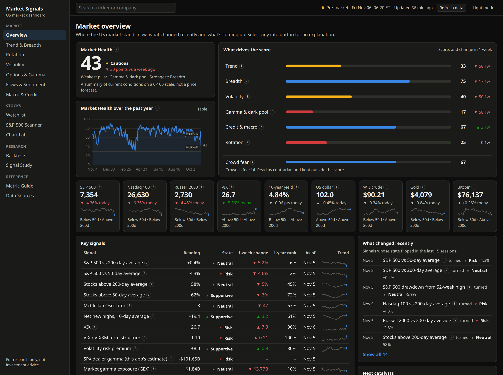

# Market Signals

**See what the US market is really doing before you buy your next stock. Free, on your own computer, with no accounts or API keys.**



<sub>The Overview the morning after a rough day: the S&P 500 fell 4.4%, and the score shows exactly which parts of the market were cracking.</sub>

## Why I made this

This repo started as a bot that was supposed to trade for me. Then I admitted to myself that I'm not going to get good enough to let code trade automatically, and that it wasn't what I needed anyway.

What I wanted was to make better decisions on the trades I make myself. Is this rally broad, or is it just a few big names? Where is money rotating to? Are people buying protection? What are option dealers likely to do if the market drops? The answers exist, but they're scattered across dozens of sites, and many of them sit behind paid subscriptions.

So I put them all in one place.

**You don't need to be a quant to use this.** If "gamma flip" means nothing to you today, that's fine. Every number has a small **i** button that tells you what it is, how to read it and how it's calculated. Click around and you'll pick it up faster than you'd expect.

## Try it

You need Python 3.11 or newer, and that's it.

```bash
git clone https://github.com/mauheems/StockSignals-Free.git
cd StockSignals-Free
python3 -m venv .venv
source .venv/bin/activate   # on Windows: .venv\Scripts\activate
pip install -r requirements.txt
python main.py
```

It opens at <http://localhost:8000>.

The first start takes a few minutes, because the app downloads its own market history. The repo doesn't include any data. You can already look around while the panels fill in. Older put/call history keeps loading in the background for about ten more minutes. From then on, data refreshes by itself while the app runs, about every 15 minutes during market hours.

I've only run it on Linux so far. Mac and Windows should work, but they're untested.

**Everything stays on your computer.** Your watchlist and data live in the local `data/` folder, the app only answers on your own machine, and it only talks to the public data sources listed below. Nothing is ever sent to me.

## What you can do with it

**Get the big picture**

| Page | The question it answers |
|---|---|
| **Overview** | How healthy is the market right now, what just changed, and what's coming up? |
| **Trend & Breadth** | Are the indices trending, and are most stocks actually taking part? 50/200-day averages, McClellan, new highs and lows |
| **Rotation** | Where is money moving? Rotation map, sector performance, risk-on and risk-off ratios |
| **Volatility** | How much movement is expected, and how stressed is that? VIX curve, realized vs implied, VVIX, SKEW, MOVE |
| **Options & Gamma** | Where are positions stacked up? Dealer gamma by strike, gamma flip, call and put walls, max pain, skew, expected move, unusual activity, for any optionable ticker |
| **Flows & Sentiment** | Is the crowd scared or greedy? Put/call ratios, dark pool index, Fear & Greed, AAII, futures positioning |
| **Macro & Credit** | Does the backdrop support stocks? Yield curve, credit spreads, liquidity, inflation, jobs |

**Look at your own stocks**

| Page | What it's for |
|---|---|
| **Watchlist** | Add any ticker and see all its signals side by side |
| **S&P 500 Scanner** | Rank and filter every member to find new names |
| **Chart Lab** | Candles, moving averages and indicators, with any market signal layered over the price |

**Check whether a signal actually works**

This is my favourite part. It's easy to believe a signal works because it sounds smart, so test it first.

| Page | What it's for |
|---|---|
| **Signal Study** | What did the market do after a signal fired, compared with any ordinary day? |
| **Backtests** | How would a strategy have done against just buying and holding? Build your own rules from any signal |

**And when you want to know more**

The **Metric Guide** explains every number in one searchable place, and **Data Sources** shows how fresh each source is.

## Where the data comes from

No sign-ups, just free public sources:

| Source | Used for | Delay |
|---|---|---|
| Yahoo Finance (`yfinance`) | Prices, indices, futures, company data | About 15 minutes for US stocks |
| Cboe | Option chains with greeks, daily put/call ratios | About 15 minutes; ratios end of day |
| SqueezeMetrics | Dark pool index (DIX) and market GEX history | Next morning |
| FRED, US Treasury | Rates, credit, liquidity, economy | Daily to monthly |
| CNN, AAII | Sentiment | Intraday, weekly |
| CFTC, FINRA | Futures positioning, off-exchange short volume | Weekly, daily |
| Federal Reserve, FRED | Economic calendar | Checked daily |
| Wikipedia | S&P 500 membership | When it changes |

So this is for planning your trades, not for timing them to the second. These sources are free and come with no guarantee, so one can change or go down at any time. When that happens, its panels keep the last good data, the Data Sources page tells you why, and everything else carries on. AAII's site, for example, sometimes answers with a bot check, and those panels then stay empty until it lets a download through.

Your data sits in `data/market.db` (about 100 MB). You can safely delete it and it will rebuild itself. You'd only lose your watchlist and the history free sources don't offer, such as daily gamma readings.

## Please don't trust it blindly

I'd rather you know the limits up front:

- **This isn't investment advice,** and the Market Health score isn't a forecast. Its thresholds are rules of thumb I chose. Test them in Signal Study and make up your own mind.
- **Gamma figures are estimates.** Public data shows how many contracts exist, not who holds them. Like the original SqueezeMetrics method, the app assumes dealers own the calls and are short the puts. Its numbers are per 1% move, while SqueezeMetrics' GEX is per 1 index point. That makes theirs look about 70 times smaller for SPX, and the two can even disagree on direction.
- **Breadth uses today's S&P 500 members,** so older readings leave out companies that later dropped from the index.
- **Backtests flatter you if you let them.** They include dividends and costs, trade at the next day's open, and only use data that was public at the time. But rules picked after seeing the data will always look better than they would have live, and cash earns no interest here.

## Make it yours

Fork it, change it, add the signals you care about. A signal only needs to be declared once in `src/analytics/signals.py` and explained in `src/dashboard/metric_guide.py`. It then works in chart overlays, backtest rules and signal studies by itself. A test fails if you forget the explanation, so nothing on screen goes unexplained.

```
main.py                 Command line
src/data/               Data sources, local store and refresh schedule
src/analytics/          Signal registry and the calculations behind it
src/backtest/, src/strategies/, src/risk/, src/visualization/
                        Backtest engine, strategies, position sizing and report charts
src/dashboard/          Web app: API, page data, Metric Guide and front end
tests/                  Unit and API tests (run with `pytest`)
tests/e2e/              Clicks through every page in a browser (see the file for usage)
```

A few handy commands:

| Command | What it does |
|---|---|
| `python main.py dashboard --port 9000 --no-browser` | Choose a port, and don't open a browser |
| `python main.py refresh` | Download the latest data once, without the dashboard |
| `python main.py backtest --symbol QQQ` | Run one backtest and write a report to `results/` |
| `python main.py info` | Show your watchlist and how fresh each source is |

Good luck out there, and happy digging.

---

Released under the [MIT License](LICENSE). The bundled ECharts charting library is under the Apache License 2.0. For research and education only.
